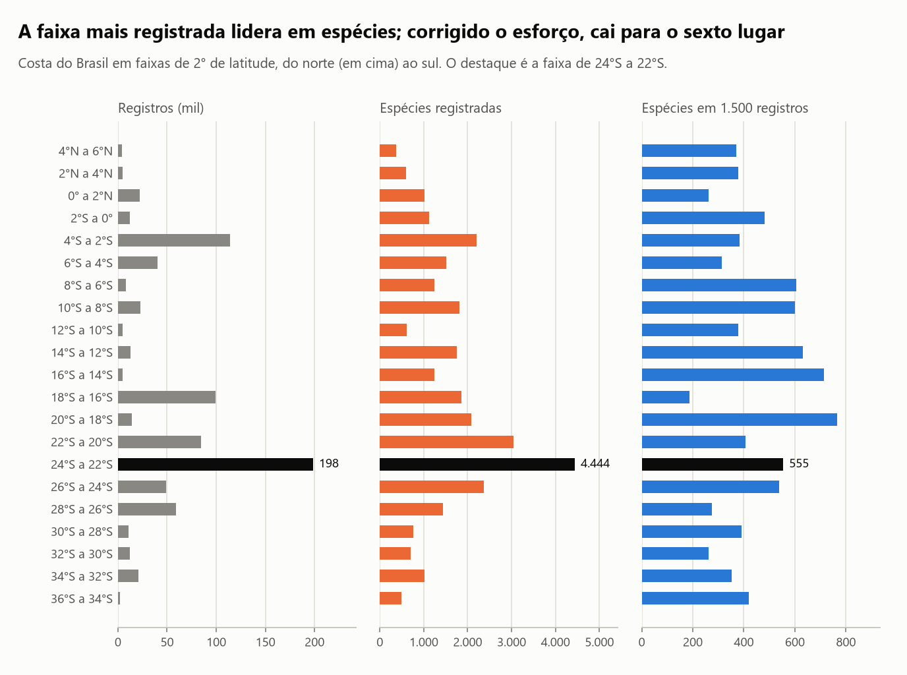
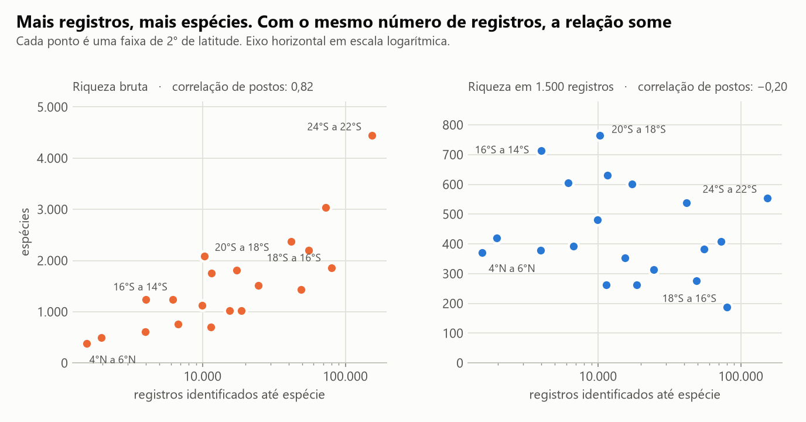
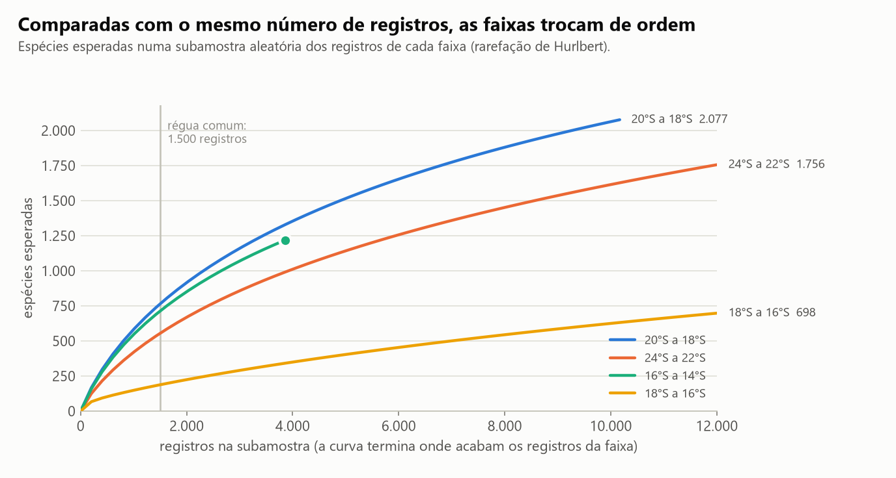
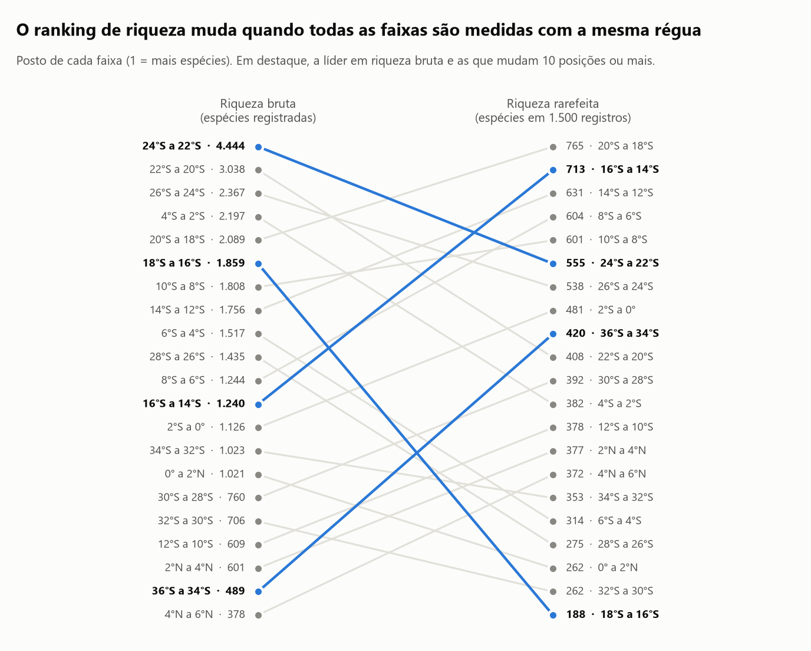
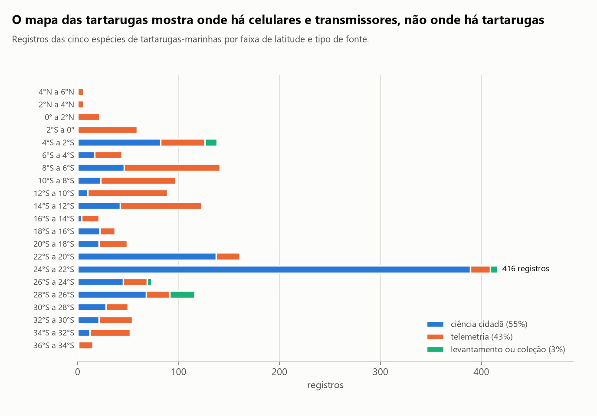

# Onde há mais espécies marinhas na costa brasileira, ou onde há mais gente olhando?

Mapas de biodiversidade costumam partir do que já foi registrado. Este projeto testa, com cerca de 800 mil registros
do OBIS na costa do Brasil, se esse retrato mostra a biologia ou o esforço de coleta.

A resposta: **a contagem de espécies registradas acompanha o número de registros (correlação de 0,82). Quando todas
as faixas do litoral são comparadas com a mesma régua, a faixa mais rica cai do 1º para o 6º lugar.** E a própria
correção tem um limite, que o projeto mede.

> **English summary.** Is the map of marine species richness along the Brazilian coast a map of biology or of
> sampling effort? Using ~800k OBIS occurrence records aggregated into 21 two-degree latitude bands, raw species
> counts track the number of records (Spearman 0.82; 10x the records gives ~2.7x the species). After rarefaction to a
> common 1,500 records the effort effect vanishes (−0.20) and the ranking changes: the most sampled band drops from
> 1st to 6th. The correction has its own limit: rarefied richness is strongly tied to how much a single dataset
> dominates a band (−0.79). Includes Chao1 completeness, a Good-Turing "where to survey next" ranking, and a
> sea-turtle case study where 97% of records are citizen science or satellite telemetry. Code and notebook are in
> Portuguese.

## Resultados

| Pergunta | Resposta |
|---|---|
| Quanto o esforço varia? | **85 vezes** entre a faixa mais e a menos registrada (198 mil contra 2,3 mil registros) |
| A riqueza bruta mede biologia? | Não: correlação de **0,82** com o número de registros; 10 vezes mais registros dão 2,7 vezes mais espécies |
| E com a mesma régua? | A relação some (**−0,20**) e a líder cai do **1º para o 6º** lugar |
| O ranking corrigido é a verdade? | Também não: correlação de **−0,79** com a fração de registros que vem de um único conjunto de dados |
| Onde um levantamento rende mais? | Sul da Bahia (16°S a 14°S): **15 espécies novas a cada 100 registros**, contra menos de 1 no litoral de SP e RJ |
| E as tartarugas-marinhas? | **97%** dos 1.770 registros são ciência cidadã ou telemetria |

Dados: 801.423 registros, 600.978 identificados até espécie, 10.349 espécies, 321 conjuntos de dados, coleta de
10/11/2026.

### 1. O esforço de coleta não é uniforme



A Zona Econômica Exclusiva do Brasil foi cortada em 21 faixas de 2° de latitude. A faixa de 24°S a 22°S (litoral de
São Paulo e do Rio de Janeiro) tem 198 mil registros e 4.444 espécies registradas. É a líder nas duas contagens, e
não por coincidência.

### 2. Contar espécies registradas é contar esforço



Em escala log-log, o número de registros explica 74% da variação da riqueza bruta. Nem a riqueza bruta nem a
corrigida mostram gradiente com a latitude neste recorte.

### 3. Com a mesma régua, o ranking muda



A rarefação (Hurlbert, 1971) responde: se cada faixa tivesse só 1.500 registros, sorteados ao acaso entre os que
tem, quantas espécies apareceriam? 1.500 é o maior número que cabe em todas as faixas.



| Faixa | Registros | Riqueza bruta (posto) | Riqueza em 1.500 registros (posto) | Faixa de 95% do sorteio |
|---|---|---|---|---|
| 24°S a 22°S (SP e RJ) | 198.492 | 4.444 (1º) | 555 (6º) | 528 a 579 |
| 20°S a 18°S (sul da BA e norte do ES) | 14.282 | 2.089 (5º) | 765 (1º) | 737 a 792 |
| 16°S a 14°S (sul da BA) | 4.613 | 1.240 (12º) | 713 (2º) | 688 a 737 |
| 18°S a 16°S (região de Abrolhos) | 99.430 | 1.859 (6º) | 188 (21º) | 168 a 206 |

O ranking corrigido resiste a duas trocas de método: usar 3.000 registros no lugar de 1.500 quase não muda a ordem
(correlação de 0,998), e refazer a conta só com peixes também a preserva (0,90).

### 4. Onde a correção falha

A rarefação supõe que os registros são uma amostra aleatória da vida de cada faixa. Não são: cada conjunto de dados
tem um alvo. Na faixa de 18°S a 16°S, um único conjunto de monitoramento de recifes responde por **60% dos
registros**, e muitos registros das mesmas espécies achatam a curva. No conjunto das 21 faixas, a riqueza rarefeita
tem correlação de **−0,79** com a fração de registros do maior conjunto de dados.

O último lugar da região de Abrolhos, conhecida justamente pelos recifes, diz mais sobre o desenho do monitoramento
do que sobre a pobreza de espécies. A rarefação corrige *quanto* se coletou; não corrige *quem* coletou e *o quê*.
O banco responde bem a "onde falta olhar" e mal a "onde há mais vida".

### 5. Onde um novo levantamento renderia mais

| Faixa | Registros | Completude (Chao1) | Espécies novas a cada 100 registros |
|---|---|---|---|
| 16°S a 14°S | 4.613 | 62% | 15,3 |
| 36°S a 34°S | 2.332 | 55% | 14,0 |
| 4°N a 6°N | 4.209 | 48% | 13,4 |
| 8°S a 6°S | 7.852 | 66% | 8,9 |
| 20°S a 18°S | 14.282 | 69% | 8,1 |
| 24°S a 22°S (para comparar) | 198.492 | 79% | 0,8 |

Nenhuma faixa passa de 79% de completude. "Espécie nova" é nova para a faixa neste banco, não para a ciência. A
conta é a de Good-Turing: espécies vistas uma única vez divididas pelo total de registros.

### 6. Estudo de caso: o mapa das tartarugas-marinhas



| Tipo de fonte | Registros | Fração |
|---|---|---|
| Ciência cidadã (fotos de plataformas abertas) | 968 | 55% |
| Telemetria (animais com transmissor) | 753 | 43% |
| Levantamento ou coleção | 49 | 3% |

A ciência cidadã se concentra onde há gente: 389 dos 416 registros da faixa de 24°S a 22°S. A telemetria desenha a
rota de poucos animais, inclusive tartarugas marcadas em outros países que cruzam águas brasileiras. O mapa mostra
onde há celulares e por onde passaram transmissores; não permite dizer onde há mais tartarugas nem onde elas
desovam. Os dados de monitoramento de praia, que responderiam a isso, não estão neste banco.

## Decisões de método

- **Só contagens agregadas.** A coleta usa `/statistics`, `/checklist` e `/dataset` da API do OBIS, por faixa.
  Nenhum registro individual é baixado nem redistribuído.
- **Concorrente simples primeiro.** A riqueza bruta é o que qualquer painel mostraria; o projeto mede o quanto ela
  engana antes de propor a correção.
- **Rarefação por fórmula, conferida por sorteio.** O valor esperado vem da fórmula de Hurlbert; 300 subamostras
  sorteadas conferem a fórmula e dão a faixa de 95%. A faixa mede só o acaso do sorteio.
- **Duas conferências de robustez** antes de afirmar que o ranking muda: outra régua (3.000) e outro grupo (peixes).
- **A correção também é auditada.** A correlação com a dominância de um conjunto de dados está na seção de
  resultados, não escondida nas limitações.

## Limitações

- **Registro não é abundância.** Mil registros de uma espécie podem ser mil indivíduos ou o mesmo ponto visitado mil
  vezes.
- **Registros não são amostra aleatória**, que é o que rarefação, Chao1 e Good-Turing supõem. Os números corrigidos
  são comparações mais justas, não estimativas da riqueza real.
- **Viés de acesso e de instituição.** A costa perto de universidades, portos e cidades grandes é mais amostrada, e
  nenhuma correção recupera o que nunca foi coletado.
- **Qualidade taxonômica.** Um quarto dos registros não chega ao nível de espécie e ficou fora das contas.
- **Faixas com pouco dado.** Duas faixas têm menos de 2 mil registros com espécie; a régua de 1.500 usa quase tudo o
  que elas têm.
- **Sem normalizar por área.** Faixas de 2° misturam costa, plataforma e mar aberto, e a área de cada uma dentro da
  ZEE é diferente.
- **Classificação das fontes** de tartarugas por palavras do título do conjunto de dados: aproximada.
- **Foto de um dia.** O OBIS cresce continuamente.

## Como rodar

Pré-requisito: [`uv`](https://docs.astral.sh/uv/getting-started/installation/).

```bash
uv sync
uv run python scripts/rodar_analise.py   # regera reports/resultados.json e as figuras a partir de data/
uv run pytest                            # 17 testes, não dependem dos dados
uv run python scripts/baixar_dados.py    # opcional: recoleta o extrato no OBIS (alguns minutos)
```

O notebook [`analise.ipynb`](analise.ipynb) conta a história completa.

## Estrutura

```text
├── analise.ipynb
├── data/                    # extrato agregado: por faixa, por espécie e faixa, por conjunto de dados
├── src/vida_marinha/
│   ├── dados.py             # coleta na API do OBIS e carga do extrato
│   ├── diversidade.py       # rarefação, Chao1, completude, Good-Turing
│   ├── analise.py           # orquestra cada tabela
│   └── graficos.py, estilo.py
├── scripts/                 # baixar_dados.py, rodar_analise.py
├── tests/                   # 17 testes (pytest)
└── reports/                 # resultados.json e figuras
```

## Dados e licença

Fonte: OBIS (2026). *Ocean Biodiversity Information System*. Intergovernmental Oceanographic Commission of UNESCO.
<https://obis.org>. Consulta em 10/11/2026 à área "Brazil: all", pela API v3.

O OBIS agrega 321 conjuntos de dados nesta área, cada um com a sua licença (CC0, CC BY ou CC BY-NC) e os seus
autores; os títulos estão em [`data/conjuntos_por_faixa.csv`](data/conjuntos_por_faixa.csv). Este repositório
redistribui apenas contagens agregadas derivadas desses dados, para fins não comerciais de estudo. O código é MIT.

---

Hélcio Venâncio · [github.com/ghitflux](https://github.com/ghitflux) · Licença MIT

Outros projetos: [`lead-scoring-conversao`](https://github.com/ghitflux/lead-scoring-conversao) ·
[`dedico-trafego-decisao`](https://github.com/ghitflux/dedico-trafego-decisao) ·
[`ab-test-simulado`](https://github.com/ghitflux/ab-test-simulado) ·
[`stats-foundations`](https://github.com/ghitflux/stats-foundations)

## Como este estudo foi feito

Este estudo foi construído com assistência de IA (Claude Code, da Anthropic), usada como par de programação.
Declaro a divisão do trabalho porque ela importa para quem avalia:

- **Meu:** a escolha do tema (biologia marinha na costa brasileira) e a direção de fazer dele um estudo de visualização de dados, a leitura crítica dos resultados e a decisão do que publicar e do que declarar como limitação.
- **Com o assistente:** a escolha do método, a implementação do código, dos testes e dos gráficos, e a redação,
  que revisei.
- **Como conferir:** todo número deste README sai de `reports/resultados.json`, gerado por `scripts/rodar_analise.py`; os testes em `tests/` conferem a rarefação e os estimadores contra casos de resposta conhecida.

É o mesmo jeito que trabalho nos sistemas que entrego: a IA acelera a implementação, e a responsabilidade pelo que
está escrito aqui é minha.

*In English: built with AI assistance (Claude Code) as a pair programmer. Direction, business context, critical
review of the results and the decision of what to publish are mine; method choice, implementation and writing were
done with the assistant and reviewed by me.*
